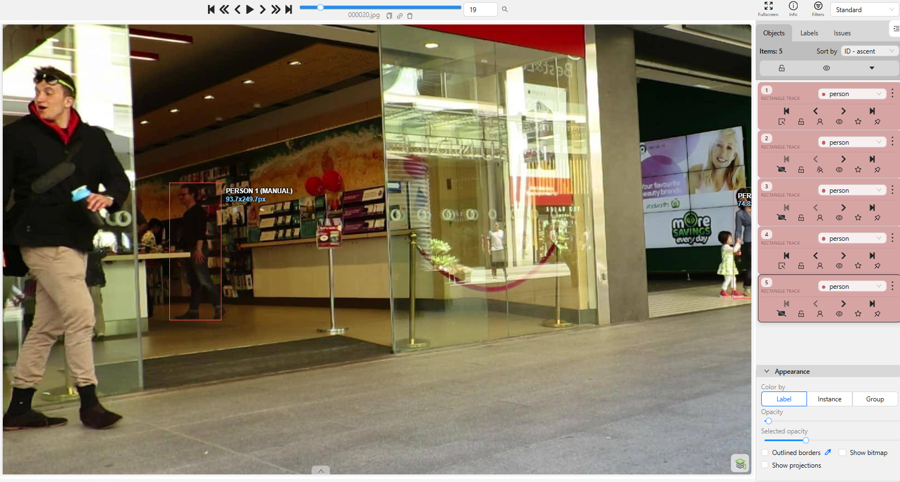
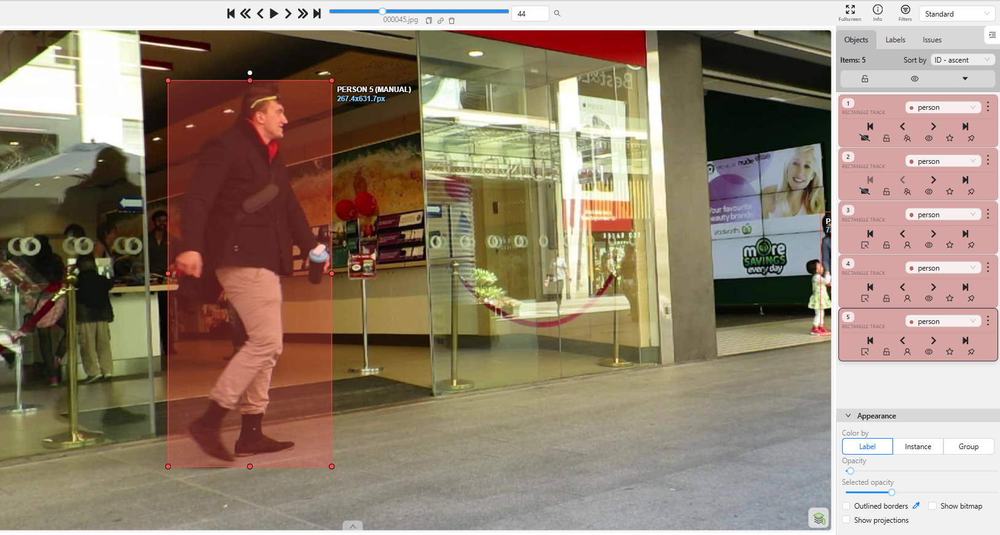
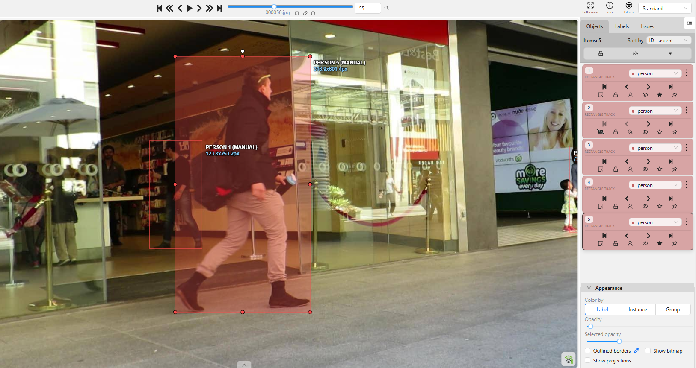

# Báo cáo cá nhân — Đinh Tuấn Thành — 2A202603231

Đoạn thực hành: MOT17-09, 150 frame, 1920×1080, 30 fps. Số frame trong báo cáo theo CVAT (0–149); số frame MOT tương ứng bằng số CVAT cộng 1.

Nguồn dữ liệu: MOT17, MOTChallenge (Milan et al., 2016), giấy phép CC BY-NC-SA 3.0.

## 0. Thông tin học viên

- Họ tên: Đinh Tuấn Thành.
- MSSV: 2A202603231.
- Mã đề: C.
- Email: tahanh68@gmail.com.
- Link repository: https://github.com/tahanh68-arch/K5-L2-Day05-DinhTuanThanh-2A202603231-MOTTracking
- Giờ bắt đầu: 16:30.
- Giờ kết thúc: 18:30.
- Tổng thời gian thực hiện: 120 phút (16:30–18:30, theo xác nhận mới nhất của học viên). Không ghi thời gian riêng cho từng người.
- Job CVAT trong file xuất: 15, frame 0–149.

Đề C gồm các MOT ID gốc `[1, 7, 20, 22, 23]`, tương ứng P1–P5 theo `src/lab_variants.json`. ID gốc, ID track trong CVAT XML và ID trong file MOT xuất ra là ba hệ đánh số khác nhau.

| Mã người | MOT ID gốc của đề | Track ID trong CVAT XML | Track ID trong MOT xuất ra |
|---|---:|---:|---:|
| P1 | 1 | 0 | 1 |
| P2 | 7 | 1 | 5 |
| P3 | 20 | 2 | 4 |
| P4 | 22 | 3 | 2 |
| P5 | 23 | 4 | 3 |

Đối chiếu P1–P5 dựa trên vị trí box chứa điểm nhận diện của đề C tại frame tham chiếu; đối chiếu MOT/XML dựa trên tọa độ box và tập frame có mặt. Việc này không thay thế kiểm tra đúng người ở toàn bộ video.

## 1. Xem trước đoạn video (CP0)

Bảng dưới được tổng hợp sau khi làm bài từ annotation và đối chiếu các ảnh gốc local tại frame CVAT 0, 30, 60, 80, 90, 100, 110, 120, 140, 149, cùng ba ảnh minh chứng. Đây không phải nhật ký xem trước được lưu trước khi vẽ. Frame đầu/cuối là frame có box trong bản nộp. Các khoảng chuyển động là nhận xét từ các mốc ảnh đã xem, không phải phép đo vận tốc hoặc frame bắt đầu rẽ/dừng chính xác.

| Mã | Frame đầu có box | Frame cuối có box | Rẽ / dừng / đổi tốc độ ở frame | Frame bật occluded khi còn box | Ghi chú |
|---|---:|---:|---|---|---|
| P1 | 0 | 149 | 0–90 di chuyển trong cửa hàng về phía cửa; khoảng 90–120 vị trí thay đổi ít hơn, sau 120 tiếp tục tiến ra cửa; chưa xác định frame dừng hẳn | 25–39, 49–54 | Áo tối màu, quần jean; có box ở 0–39 và 49–149; outside 40–48 |
| P2 | 60 | 149 | 60–149 đi từ trong cửa hàng về phía cửa; chưa thấy rẽ/dừng đột ngột ở các mốc đã xem | 60–79, 82 | Áo sáng màu có dải màu phía trước, quần tối màu; có box liên tục 60–149 |
| P3 | 39 | 149 | Tiến gần camera trong đoạn 39–149, kích thước người tăng rõ ở 90–149; chưa thấy đổi hướng đột ngột ở các mốc đã xem | Không bật trong bản xuất | Áo xanh lam, đội mũ sáng màu; có box liên tục 39–149 |
| P4 | 1 | 104 | Vị trí gần cửa Woolworths thay đổi ít ở các mốc 0–90; chưa xác định frame rẽ hoặc dừng riêng | 92–104 | Áo xám/xanh, mang túi hồng, cạnh trẻ nhỏ; bị người tiền cảnh che dần, outside từ 105 |
| P5 | 25 | 135 | Khoảng 30–60 đổi tư thế từ nhìn sang trái sang đi về bên phải; 60–110 di chuyển chéo sang phải và xa camera hơn | 114–118, 129–135 | Áo khoác đen, quần sáng màu, túi đeo chéo; outside 119–128, hiện lại 129; outside từ 136 |

## 2. Keyframe và thời gian (CP1, CP4)

Số liệu lấy từ `src/check_submission.py` trên hai ZIP bài nộp. Keyframe được đếm khi track có mặt (`outside=0`), theo cách tính của script; keyframe bật outside không tính vào cột số keyframe.

| Mã | Số keyframe | Keyframe ở frame | Số frame có mặt | Keyframe / 100 frame | Thời gian (phút) | Chỗ cần chú ý trong annotation |
|---|---:|---|---:|---:|---|---|
| P1 | 25 | 0, 3, 20, 25, 49, 52, 53, 54, 55, 61, 62, 64, 67, 78, 88, 98, 109, 118, 119, 128, 138, 139, 143, 148, 149 | 141 | 17,7 | Chưa ghi riêng | Chuyển cờ ở 25, 40, 49, 55; nhiều keyframe quanh lúc hiện lại |
| P2 | 19 | 60, 70, 74, 78, 80, 82, 83, 89, 90, 97, 102, 112, 122, 124, 132, 140, 142, 144, 149 | 90 | 21,1 | Chưa ghi riêng | Occluded ở 60–79 và 82 |
| P3 | 12 | 39, 49, 59, 69, 79, 89, 99, 109, 119, 129, 139, 149 | 111 | 10,8 | Chưa ghi riêng | Keyframe cách nhau 10 frame; vẫn cần kiểm tra nội suy giữa các mốc |
| P4 | 6 | 1, 11, 21, 31, 41, 92 | 104 | 5,8 | Chưa ghi riêng | Khoảng keyframe 41–92 dài; cần kiểm tra box có trôi hay không |
| P5 | 16 | 25, 35, 45, 55, 65, 75, 85, 95, 105, 111, 114, 118, 129, 130, 134, 135 | 101 | 15,8 | Chưa ghi riêng | Mất hẳn 119–128; hiện lại 129; kết thúc thấy được ở 135 |
| **Tổng** | **78** | — | **547** | **14,3** | **120 phút cho toàn bộ bài; không ghi riêng từng người** | — |

Mật độ keyframe cả bài = 78 ÷ 547 × 100 = **14,26**, làm tròn **14,3 keyframe / 100 frame**. Không người nào vượt ngưỡng cảnh báo 50 keyframe / 100 frame.

P1 có nhiều keyframe nhất (25). File XML cho thấy nhiều keyframe ở đoạn xuất hiện lại (49, 52–55) và các mốc thay đổi cờ che khuất. Quan sát ảnh gốc cho thấy P1 di chuyển trong cửa hàng về phía cửa, vị trí và dáng người thay đổi qua đoạn che. Đây là những đoạn cần kiểm tra nội suy kỹ, thay vì chỉ đặt keyframe đều theo thời gian.

## 3. Đoạn bị che (CP2)

Người bị che: **P1**, track XML **0**, track MOT xuất ra **1**.

| Mốc | Frame CVAT |
|---|---:|
| Bắt đầu bị che một phần (bật occluded) | 25 |
| Mất hẳn (bật outside) | 40 |
| Hiện lại (tắt outside) | 49 |
| Thấy rõ trở lại (tắt occluded) | 55 |

- Bản xuất đã được học viên xác nhận là bản chỉnh lại: dùng mốc **40 và 55**, thay cho ghi nhận ban đầu **42 và 56**.
- Khuất hẳn ở frame **40–48**, tổng cộng **9 frame = 9/30 = 0,30 giây**.
- Quyết định thể hiện trong annotation: **giữ cùng ID** khi hiện lại ở frame 49.
- Thời gian khuất 9 frame nhỏ hơn ngưỡng 60 frame của lớp. Trước và sau che, P1 đều mặc áo tối màu, quần jean, có dáng người và kiểu tóc phù hợp. Người hiện lại vẫn ở trong cửa hàng, gần vị trí trước khi khuất và tiếp tục di chuyển về phía cửa; không có dịch chuyển xa bất hợp lý trong 0,30 giây. Các dấu hiệu ngoại hình, vị trí và hướng đi này hỗ trợ giữ cùng ID, thay vì chỉ dựa vào màu áo. Track XML 0 / MOT 1 giữ cùng số trước và sau đoạn che; không có phép đo tốc độ thực theo mét/giây.
- Ở frame 49–54, outside đã tắt nhưng occluded còn bật; occluded tắt từ frame 55.
- Đã đối chiếu MOT: không có dòng của track 1 tại frame CVAT 40–48 (frame MOT 41–49).

Ảnh chụp màn hình job thật, số frame theo CVAT. Nguồn hình: MOT17, MOTChallenge (Milan et al., 2016).



*Trước che, frame 19: P1 ở trong cửa hàng, box mang ID 1.*



*Trong đoạn che, frame 44: box P1 không hiển thị; track 1 còn trong panel Objects với biểu tượng outside bật. Box lớn đang chọn là PERSON 5, người ở phía trước, không phải P1.*



*Sau che, frame 55: box PERSON 1 hiển thị lại với cùng ID 1. Box lớn đang chọn trong ảnh là PERSON 5; box P1 nhỏ hơn ở phía sau.*

## 4. Tự review ID (CP3)

Đã kiểm hai lượt, không phát hiện lỗi: lượt 1 theo từng người từ frame 149 về 0; lượt 2 theo toàn cảnh, nhảy 10 frame. Đây là kết quả tự review do học viên xác nhận, không phải kết luận từ ground truth.

| Frame | Mã người | Loại lỗi | Mô tả một câu | Phát hiện ở lượt | Đã sửa? |
|---:|---|---|---|---|---|
| 0–149 | P1–P5 | Không phát hiện | Đã kiểm hai lượt, không lỗi được phát hiện | Cả hai lượt | Không có lỗi được ghi nhận để sửa |

Tổng hợp số lỗi phát hiện qua tự review:

| id_switch | fragmentation | lost | merge | false_track | drift | flag |
|---|---|---|---|---|---|---|
| 0 | 0 | 0 | 0 | 0 | 0 | 0 |

Lỗi nào chỉ lượt 2 (theo cảnh) mới thấy, lượt 1 (theo người) không thấy? Vì sao?

Không phát hiện lỗi ở cả hai lượt, nên không có lỗi chỉ được phát hiện ở lượt 2 để so sánh.

## 5. File xuất và kết quả tự kiểm (CP4)

| Kiểm tra | Kết quả |
|---|---|
| Tên file MOT 1.1 | `src/exports/DinhTuanThanh_mot.zip` |
| Tên file CVAT for video 1.1 | `src/exports/DinhTuanThanh_cvat_video.zip` |
| Số track ID khác nhau trong MOT | **5** |
| Tổng số box / frame có mặt cộng theo các track | **547** |
| Tổng số keyframe có mặt trong XML | **78** |
| Frame outside không có dòng trong MOT | **Đúng**; đã đối chiếu cả 5 track |
| Tập frame có mặt của từng track giữa MOT và XML | **Khớp cả 5 track** |
| ZIP không kèm ảnh | **Đúng**; MOT chỉ có `gt/gt.txt`, `gt/labels.txt`; CVAT chỉ có `annotations.xml` |
| Job đã completed trên CVAT local | **Đã completed, theo xác nhận của học viên** |
| Kết quả script | **0 lỗi, 0 cảnh báo; mã thoát 0** |
| Ảnh minh chứng CP2 | **Đủ 3 ảnh** tại frame CVAT **19, 44, 55**, đã nhúng trong mục 3 |

Lệnh chạy từ thư mục gốc repo:

```powershell
python src/check_submission.py --mot src/exports/DinhTuanThanh_mot.zip --cvat src/exports/DinhTuanThanh_cvat_video.zip
```

Kết quả thực tế:

```text
Số frame in theo CVAT (bắt đầu từ 0). Trong gt.txt, frame_id = frame CVAT + 1.

=== File MOT 1.1: DinhTuanThanh_mot.zip ===
  Số track ID: 5   |   Tổng số box: 547
  [OK]        Đúng 5 track ID.

  Track | Frame có mặt | Số frame | Đoạn vắng (outside)
      1 |   0–149      |      141 | 40–48
      2 |   1–104      |      104 | -
      3 |  25–135      |      101 | 119–128
      4 |  39–149      |      111 | -
      5 |  60–149      |       90 | -


=== File CVAT for video 1.1: DinhTuanThanh_cvat_video.zip ===

  Track | Nhãn   | Frame thấy | Keyframe | KF/100 frame | Frame occluded | Lần bật outside
      0 | person |        141 |       25 |         17.7 |             21 |               1
              Track 0: keyframe ở frame [0, 3, 20, 25, 49, 52, 53, 54, 55, 61, 62, 64, 67, 78, 88, 98, 109, 118, 119, 128, 138, 139, 143, 148, 149]
      1 | person |         90 |       19 |         21.1 |             21 |               0
              Track 1: keyframe ở frame [60, 70, 74, 78, 80, 82, 83, 89, 90, 97, 102, 112, 122, 124, 132, 140, 142, 144, 149]
      2 | person |        111 |       12 |         10.8 |              0 |               0
              Track 2: keyframe ở frame [39, 49, 59, 69, 79, 89, 99, 109, 119, 129, 139, 149]
      3 | person |        104 |        6 |          5.8 |             13 |               1
              Track 3: keyframe ở frame [1, 11, 21, 31, 41, 92]
      4 | person |        101 |       16 |         15.8 |             12 |               2
              Track 4: keyframe ở frame [25, 35, 45, 55, 65, 75, 85, 95, 105, 111, 114, 118, 129, 130, 134, 135]

  Tổng: 78 keyframe / 547 frame có mặt = 14.3 keyframe / 100 frame
  [OK]        Đọc được 5 track từ annotations.xml.

=== Tóm tắt ===
  Lỗi: 0   |   Cảnh báo: 0
  Đạt. Dán phần tóm tắt này vào báo cáo mục 5.
```

Script không có ground truth, không tính MOTA/IDF1 và không xác nhận box bám đúng người ở toàn bộ clip. Không có lỗi/cảnh báo từ script vẫn cần review trên CVAT.

## 6. Ba câu kết

Câu 1 và 2 ghi lại nhận xét học viên đã cung cấp. Câu 3 là phần giải thích khái niệm có hỗ trợ AI theo yêu cầu của học viên; tình huống được ghi rõ là giả định, không phải lỗi đã phát hiện trong bài.

1. Nếu được gán lại, bạn sẽ đặt keyframe khác ở đâu? Vì sao?

   Tôi chưa có vị trí nào muốn thay đổi cách đặt keyframe. Qua hai lượt review, tôi không phát hiện lỗi cần sửa.

2. Có chỗ nào bạn không chắc “cùng ID hay ID mới”? Bạn đã quyết định và ghi chú thế nào?

   Không có chỗ nào tôi phân vân giữa giữ cùng ID và tạo ID mới. Với P1, tôi giữ cùng ID sau đoạn che khuất đã ghi ở mục 3.

3. Một lỗi ID trong job của bạn (nếu không còn sót, chọn lỗi đã sửa) có thể làm xe tự lái dự đoán sai chuyển động của người đó như thế nào? Lỗi đó ảnh hưởng MOTA hay IDF1 nhiều hơn?

   Qua hai lượt tự review, tôi không phát hiện lỗi ID và không có lỗi ID đã sửa để mô tả. Xét tình huống giả định: nếu sau khi P1 bị che, ID của P1 bị gán sang người khác, chuỗi vị trí của cùng ID sẽ nối hai người khác nhau. Hệ thống có thể suy ra vận tốc hoặc hướng di chuyển thay đổi đột ngột, dẫn đến dự đoán sai quỹ đạo của người đi bộ và đánh giá sai khả năng người đó đi vào đường xe chạy.

   MOTA giảm do thành phần lỗi đổi ID (IDSW) trong công thức `MOTA = 1 − (FN + FP + IDSW) / GT`. IDF1 đánh giá việc giữ đúng danh tính trên toàn bộ track; nếu một lần đổi ID làm sai danh tính kéo dài qua nhiều frame, IDF1 thường phản ánh vấn đề này rõ hơn, kể cả khi box vẫn bám đúng người. Không thể kết luận mức giảm cụ thể của MOTA và IDF1 khi chưa so với ground truth.

## Bonus (nếu làm)

Chưa cung cấp minh chứng thực hiện bonus; không ghi nhận kết quả bonus.

## 7. Tài liệu tham khảo và công cụ AI đã dùng

- MOT17, MOTChallenge (Milan et al., 2016), CC BY-NC-SA 3.0: nguồn dữ liệu thực hành.
- Tài liệu repo: `CHECKPOINTS.md`, `docs/GUIDELINE.md`, `docs/MOT_FORMAT.md`, `SUBMISSION.md`, `RUBRIC.md`, `RULES.md`.
- `src/lab_variants.json`: danh sách người mục tiêu của đề C.
- `src/check_submission.py`: kiểm tra định dạng, thống kê track/keyframe và cảnh báo.
- ChatGPT/Codex: hướng dẫn thao tác CVAT; đọc hai file xuất do học viên gán tay, chạy script tự kiểm, đối chiếu ID/frame/cờ và tổng hợp số liệu; đối chiếu các mốc ảnh gốc để bổ sung nhận xét chuyển động và lý do giữ ID; giải thích ảnh hưởng của lỗi ID đến dự đoán chuyển động, MOTA và IDF1 bằng tình huống giả định ở mục 6 câu 3 theo yêu cầu của học viên. Nội dung tự review và câu 1–2 ở mục 6 dựa trên xác nhận của học viên. Không sinh hoặc sửa box/track trong file nộp.
